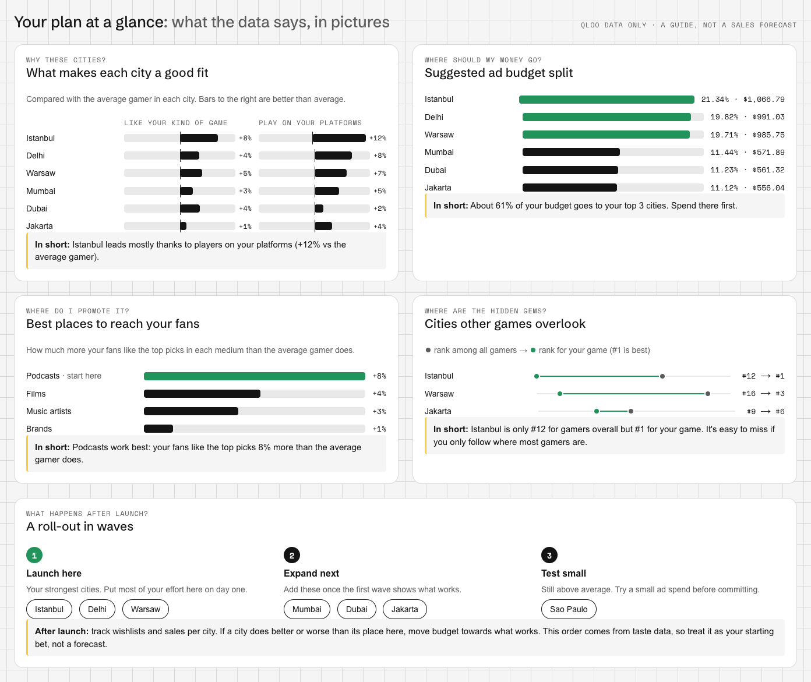
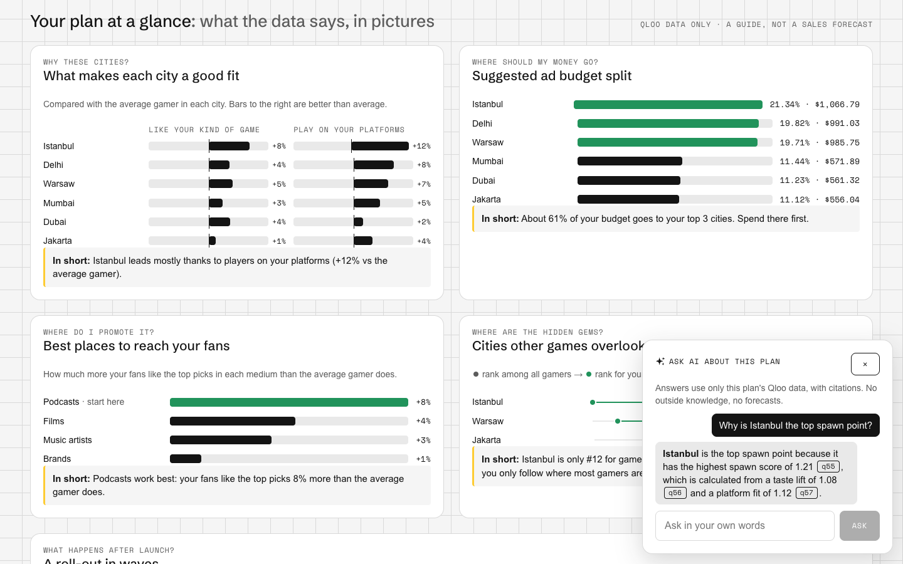
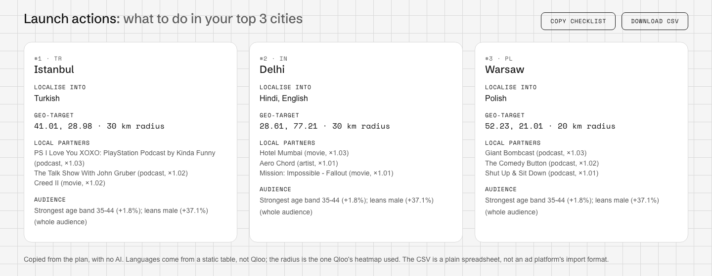
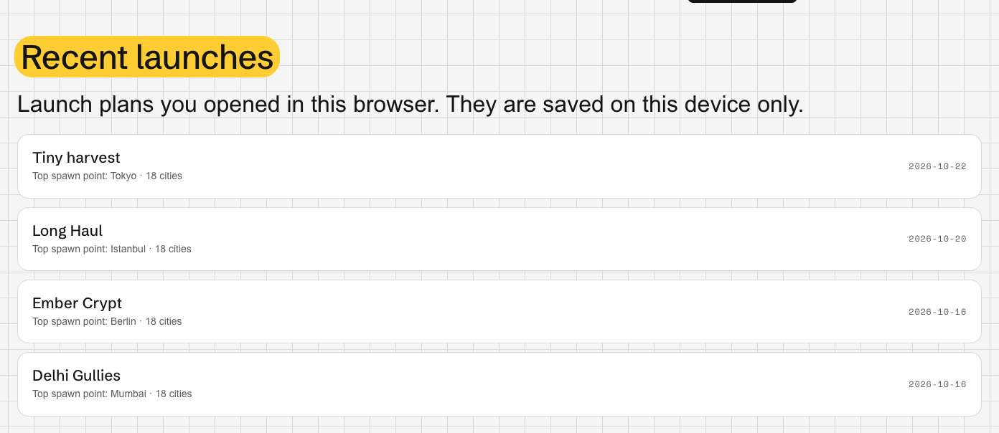

<p align="center">
  
</p>

<p align="center">
  <a href="https://crowdspawn.vercel.app"><b>Live demo</b></a> ·
  <a href="#try-it-in-2-minutes">Try it</a> ·
  <a href="#for-judges-evidence-by-criterion">For judges</a> ·
  <a href="#quick-start">Quick start</a> ·
  <a href="#three-ways-in">Features</a> ·
  <a href="#how-it-works">How it works</a> ·
  <a href="#trust-and-limits">Limits</a> ·
  <a href="CONTRIBUTING.md">Contributing</a>
  <br>
  <sub>Built for the Qloo Agentic Hackathon 2026 · MIT licensed</sub>
</p>

<p align="center">
  
</p>

**Crowdspawn tells indie game studios where their players already are, and who they love, with every number traced to Qloo.**

Describe your game and an agent builds a launch plan from [Qloo Taste AI](https://qloo.com) data: the cities where fans of games like yours over-index against all gamers, who that audience is, which artists, podcasts, films and brands they love more than gamers in general, and what to do in your top 3 cities. An LLM plans the steps and writes the words but never supplies a fact: every city, name and number traces back to the Qloo call behind it. It is a taste-informed starting hypothesis, not a forecast; [how accurate it is](#is-it-right) is published below.

## Try it in 2 minutes

**Live demo: [crowdspawn.vercel.app](https://crowdspawn.vercel.app)** (no sign-in, no keys; API health: [crowdspawn.onrender.com/health](https://crowdspawn.onrender.com/health)). If the API has been idle, the first request can take up to a minute; the app says so while it waits.

1. **Open the sample** (`/sample`): a saved plan for Long Haul, a trucking sim. The note at the top says what our evaluation found for this game.
2. **Type a game into "Plan my launch"** on the home page, or click an example. Each agent step streams in; every claim in the answer has a chip that jumps to the step behind it.
3. **Click a city, then "Scout this city"**: the region scout opens with your plan's games and judges that city against 8 world cities.
4. **Press "Ask this plan"** (bottom right of any plan) and ask a question in your own words. The answer uses only that plan's Qloo data and cites it.

If the day's Qloo budget runs out, new plans and scouts fail closed with a clear message. The samples (`/sample`, `/sample/delhi`), the accuracy page (`/accuracy`), the 50 pre-scouted places on `/scout`, and any input asked before (the demo inputs are warmed) still answer from cache. Press **Tour** in the nav for a one-minute walk-through.

## For judges: evidence by criterion

Every claim below links to something you can open or run. Weak points are listed too.

| Criterion | What to look at | Evidence |
|---|---|---|
| **Qloo integration and technical work** | 8-tool agent; 7 Qloo endpoint families; every number traced to its call | [Agent loop](https://github.com/divyanshu-patil/Crowdspawn/blob/main/apps/api/src/crowdspawn_api/pipeline/agent.py) · [call trace of the sample](https://crowdspawn.vercel.app/sample/trace) · [verified API contract](https://github.com/divyanshu-patil/Crowdspawn/blob/main/docs/qloo-contract.md) · kill switch: no Qloo key → no plan, and swapping the LLM changes only the wording ([tests](https://github.com/divyanshu-patil/Crowdspawn/blob/main/apps/api/tests/test_api.py#L84)) · 144 API tests (94% coverage) + 35 web tests in CI |
| **Does it beat an LLM alone?** | Partners: yes, an LLM gives the same names whatever the game. Audience: matches a survey, LLM nearly ties. Country ranking: no. All published, and every plan has a side-by-side "Qloo vs an LLM alone" | [Partner check](https://github.com/divyanshu-patil/Crowdspawn/blob/main/docs/partner-check.md): on 20 games, 32% of the LLM's artists recur in 3+ games vs 5% of Qloo's (films 15% vs 3%; brands are the exception, 67% vs 51%) · [Audience check](https://crowdspawn.vercel.app/accuracy): Qloo's gender skew vs a 270,000-gamer survey, ρ 0.997 (LLM guess 0.991) · [held-out ranking test](https://crowdspawn.vercel.app/accuracy): LLM 4/23 vs Crowdspawn 1/23, plus the [fixes we tried](https://github.com/divyanshu-patil/Crowdspawn/blob/main/docs/scenario-results.md) |
| **Design and usability** | One front door, live streamed steps, citation chips, guided Tour; plain-language charts with a one-line takeaway each; a chat that answers only from the plan's data; recent launches | [Live demo](https://crowdspawn.vercel.app) · [sample plan](https://crowdspawn.vercel.app/sample) · Lighthouse accessibility 100 on every page · works at 360 px |
| **Impact** | Ends in decisions: languages, geo-targets, local partners, CSV | [Launch actions on the sample](https://crowdspawn.vercel.app/sample) · [how studios choose today](#who-its-for) |
| **Originality** | Culture anchors turn films and music into geography; partners ranked by lift over all gamers, per city; "where to market first" ranks music, podcasts, films and brands by how much these fans stand out in each | [Spawn score](#how-it-works) · [Delhi Gullies sample](https://crowdspawn.vercel.app/sample/delhi): Mumbai first via culture fit 2.45 |

## Three ways in

### 01 · Plan my launch — `/` · `/agent`

One box on the home page: describe your game and what you want to decide. An LLM plans step by step with Qloo tools (`search_games`, `search_culture`, `find_place`, `rank_cities`, `scout_place`, `audience`, `find_partners`, `finish`), and each step streams live with its reasoning and what Qloo returned.

| Each step, live | The answer, checked against Qloo |
|---|---|
|  |  |

- **It can't invent ids.** The agent refers to entities by handles the server issues (`g1`, `c2`, `p1`).
- **It can't invent facts.** Its answer may only use names and numbers from tool results, and every sentence that names a city, a partner or a number must cite the step it came from (`[s3]`). The citations render as chips that scroll to that step. If the answer fails the check twice, a template built from the Qloo ranking replaces it.
- **It's bounded.** At most 10 steps, 12 LLM calls and 150 Qloo calls per run. Auth, budget and rate-limit errors fail closed.
- **It hands off.** "Open as a launch plan" fills the plan form with the agent's picks. If the LLM is down, "Build the plan yourself" carries your description to the form, which needs no LLM.

### 02 · Get a launch plan — `/sample` · `/plan/new`

From the agent's hand-off, or by hand under "Advanced: pick comps yourself": your game and platforms, then comparable games and the culture your setting draws on (the LLM suggests names; Qloo must resolve them), then the cities to score. The plan streams in step by step.


- **Spawn points: where to launch.** Cities ranked by spawn score, each with a confidence level, a budget share and a "Scout this city" link.
- **Rivals: games your fans also love,** with Qloo's reasons. **Who's in the party:** the audience's age and gender skew.
- **Allies: partners to recruit.** Artists, podcasts, films and brands ranked by lift: how much more your comps' fans like them than gamers in general do, globally and in each top city. Anything at or below ×1 is dropped.
- **Where to market first:** music, podcasts, films and brands ranked by the median lift of each list, so a studio knows which medium these fans stand out in.
- **Qloo vs an LLM alone:** one click asks an LLM the same question with no Qloo data, looks up every name it gives in Qloo and scores it the same way, side by side with the plan. Its answers are labelled and never used in the plan.
- **Launch actions: what to do in your top 3 cities.** Languages to localise into, a geo-target (centre and radius), the top local partners and the audience skew, as a checklist to copy or a CSV. Copied from the plan, with no AI.
- **Battle plan: the brief.** Written only from the plan's facts. Each citation chip (`q12`) opens the Qloo call behind it.
- **Gap view (optional):** tastes you share with your last game, and new ground.
- **Recent launches** (`/recent`, in the nav): every plan you opened in this browser, newest first. Kept in the browser only; there are no accounts.

**Your plan at a glance.** Right under the city ranking, five plain charts for a studio that doesn't read statistics. Each asks a question a developer would ask and ends with a one-line "In short":

- *Why these cities?* What puts each city ahead: fans of games like yours, players on your platforms, fans of your setting, each shown as "+12% vs the average gamer". A factor that is the same everywhere (platform, when you pick PC, mobile and console) is left out and the chart says why.
- *Where should my money go?* The suggested budget split.
- *Where do I promote it?* Music, podcasts, films and brands ranked by how much more your fans like them, with "start here" on the best.
- *Where are the hidden gems?* Cities that rank far higher for your game than for gamers overall.
- *What happens after launch?* A roll-out in three waves (launch here, expand next, test small), ordered by rank and confidence. No dates or results are predicted; it says to track wishlists and sales per city and move budget to what works.



**Ask this plan.** A chat on every plan, marked with an AI icon. Ask "Why is Istanbul first?" or "Which podcasts stand out?" and the LLM answers from that plan's Qloo facts only, with citation chips. Each answer goes through the same grounding check as the brief: a city, name, number or citation that isn't in the plan gets one rewrite, then the answer is withheld. Questions the data can't answer, like revenue, get a plain "this plan doesn't answer that". It makes no Qloo calls.





<details>
<summary><b>See the rest of the plan</b>: rivals, partners, brief, call trace, and the form</summary>

<br>




</details>

### 03 · Scout a region — `/scout`

What works in a place? A pixel world map with real country borders, shaded by each country's **gamer taste match**. That's a 0–100 taste score built from PC, console and mobile hit-game panels, not a player count; Qloo has no player counts.


Click anywhere, search a town or hover a popular place to zoom to it. You see the genres that over-index there, against all gamers in the area, and the games locals love. 50 popular places are pre-scouted into a bundled Qloo snapshot and answer instantly.


**Will my game work here?** Describe your game (or arrive from a plan's "Scout this city", which brings the plan's games, so the LLM proposes no names) and get a loot-rarity verdict (Legendary, Epic, Rare, Uncommon, Common). Each word is a band of the spawn score, stricter when Qloo's data is thinner: Legendary needs 1.15 or more at high confidence. It is not a probability. You also get a ranking against 8 world cities and the names Qloo matched.


## How it works

<p align="center">
  
</p>

Every city is ranked by one transparent score. Each factor is a ratio of Qloo affinity ranks, with no tuned weights:

<p align="center">
  
</p>

- **Taste lift:** how much fans of your comparable games concentrate in the city, compared with all gamers there. "All gamers" is the mean of PC, console and mobile player panels.
- **Platform fit:** how strong your platforms are in that city.
- **Culture fit:** how concentrated fans of your setting's films, shows and music are, relative to the average city.

### Is it right?

Not yet, on its own. We wrote 23 held-out test games with no home-country setting and froze them before scoring. For each, Google Trends interest for a real shipped game like it (never a comp) is the truth, and every method ranks the same candidate countries:

| Method | Trends #1 is our #1 | Trends #1 in our top 3 | Mean ρ |
|---|---|---|---|
| Crowdspawn (Qloo spawn score) | 1 of 23 | 1 of 23 | 0.11 |
| LLM only (gemma4:31b) | 4 of 23 | 7 of 23 | 0.54 |
| Popularity (all gamers, no game signal) | 0 of 23 | 1 of 23 | -0.33 |

An LLM with no Qloo data did better. The ranking has a city bias: its #1 city was Stockholm for 9 and Istanbul for 6 of the 23 games, whatever the genre. It does better when a game has a real-world setting, where culture anchors carry the signal. On the 10-game tuning set (9 shipped games and 1 cancelled one, Mumbai Gullies) it found the #1 in 6 of 10 (5 of the 9 shipped), the same as the LLM (6 of 10), but the scorer was designed on those games. A Steam-review backtest on 6 shipped games also lost to plain popularity. After the loss we tried the obvious fixes on all 33 games (removing each city's average lift, the old mainstream baseline, blending Qloo's ranking into the LLM's); none closed the gap, so the scorer is unchanged. Everything is published: [`docs/scenario-results.md`](docs/scenario-results.md), [`docs/backtest-results.md`](docs/backtest-results.md), and the app's "How accurate is it?" page (`/accuracy`). Beyond the country ranking, Qloo supplies what an LLM would have to guess: the audience skew, partners measured against all gamers in each city, and a trace for every number.

**Partners: Qloo is specific where an LLM is generic.** We gave an LLM (gemma4:31b, no Qloo data) the same inputs for 20 games and asked for 6 artists, podcasts, films and brands each. It named the same artists for many games: 32% of its artist picks recur in 3 or more of the 20 games (Aphex Twin, Carpenter Brut, Perturbator), against 5% of Qloo's. Films: 15% vs 3%. Podcasts: 32% vs 20%, and Qloo could find only 51 of its 103 podcasts. Brands are the exception: Qloo's brand lists repeat more (67% vs 51%). This measure doesn't use Qloo's scores. Scored by Qloo (which favours Qloo's own lists by design), 43% of the LLM's artists, 53% of its films and 72% of its brands are liked no more by these fans than by gamers in general. Every plan shows the comparison side by side ("Qloo vs an LLM alone"). Details: [`docs/partner-check.md`](docs/partner-check.md).

**The audience skew checks out.** For 10 genres, Qloo's female index for a panel of well-known games orders them exactly as Quantic Foundry's 2017 survey of about 270,000 gamers does (Spearman ρ 0.997; design fixed before any call). An LLM's guess also matched (ρ 0.991), likely from memory of that published survey; Qloo measures the skew for whatever comp set a studio picks. Details: [`docs/audience-check.md`](docs/audience-check.md).

<details>
<summary><b>The Qloo call chain</b>: each plan step and the call behind it</summary>

<br>

All parameters were verified live and recorded in [`docs/qloo-contract.md`](docs/qloo-contract.md).

| Step | Qloo call | Output |
|---|---|---|
| S1 Resolve comps and culture | `/entities` or `/search` | Real Qloo ids for comps and culture anchors; unknown names are dropped, never invented |
| S2 Expand | `/v2/insights` video games + explainability | 20 similar games with the comps that drive each one |
| S3 Cities | `urn:heatmap` for the comps, the platform panels and the culture anchors | Spawn score with confidence |
| S4 Audience | `urn:demographics` | Age and gender over/under-index |
| S5 Partners | `/v2/insights` artist, podcast, movie, brand (+ `signal.location` for the top 3 cities), each re-scored against all gamers with `filter.entities` | Partners ranked by lift vs all gamers, with Qloo's reasons |
| S6 Gap (optional) | `/v2/analysis/compare` | Tastes shared with your last game vs new ground |
| S7 Budget | none, deterministic | Split by spawn score × confidence, sums to exactly 100% |
| S8 Brief | none, LLM over S1–S7 facts | Prose citing `[q12]` result ids, validated before display |

A plan with 5 comps, 4 culture anchors and 18 cities uses about 120 Qloo calls, 26 of them for partners. The per-run cap is 140. Player panels are shared and cached, so a new plan usually costs about 2 live calls per city, and 0 on repeat.

</details>

<details>
<summary><b>The swap and kill-switch tests</b>: proof that Qloo is load-bearing</summary>

<br>

- **Every fact is traced.** Every city, entity, score and audience figure carries `source: "qloo"` and a `result_id` in the trace. A grounding validator rejects any city, bold name, number or citation not present in the Qloo results. It regenerates once, then falls back to a template.
- **Kill switch.** With `QLOO_API_KEY` empty or wrong, a plan ends `failed` with `qloo_unconfigured` / `qloo_auth`. No cities or brief are produced and no LLM call is made (`tests/test_api.py::test_kill_switch_*`).
- **LLM swap.** Switching `LLM_PROVIDER` between `ollama_cloud`, `gemini`, `openai_compat` and `fake` changes only the brief; the rest of the plan JSON is identical (`test_provider_swap_changes_only_brief`). Only `apps/api/src/crowdspawn_api/llm/` names a provider.


</details>

## Quick start

Requirements: Node 24+, pnpm 11 and [uv](https://docs.astral.sh/uv/). uv fetches Python 3.12 for you.

```sh
pnpm install                                   # also runs `uv sync` for the API
cp apps/api/.env.example apps/api/.env         # fill in QLOO_API_KEY and OLLAMA_API_KEY
cp apps/web/.env.example apps/web/.env.local
pnpm dev                                       # web http://localhost:3000 · API http://localhost:8000
```

- **No keys:** `/sample` and the 50 bundled scout places still work.
- **No `OLLAMA_API_KEY`:** plans still work, and the brief falls back to a grounded template.
- **No `QLOO_API_KEY`:** nothing is produced. That's by design.

| Command | What it does |
|---|---|
| `pnpm dev` | Web + API with hot reload |
| `pnpm test` | API pytest on recorded Qloo fixtures (no network, 80% coverage gate) + web Vitest |
| `pnpm lint` · `pnpm check-types` | ruff + ESLint · mypy --strict + tsc |
| `pnpm build` | Exports `openapi.json` and builds the Next.js app |
| `pnpm contracts` | Regenerates the TypeScript API types |

To put a demo online, see [`docs/DEPLOY.md`](docs/DEPLOY.md). Full setup and contribution rules are in [`CONTRIBUTING.md`](CONTRIBUTING.md).

## Trust and limits

- **The LLM never supplies data.** It proposes names, which Qloo must resolve, and writes words that are checked against Qloo results. That includes "Ask this plan": an answer that leaves the plan's data is withheld.
- **The charts are not a forecast.** They redraw the plan's own Qloo numbers. The roll-out waves are an order to try cities in, with no dates or outcomes.
- **Fail closed.** Without a working Qloo key nothing is produced.
- **No personal data.** Qloo's taste data is PII-free, Crowdspawn stores none, and keys never reach the browser.
- **An affinity index, not a sales or wishlist forecast.** Scout verdicts (Legendary to Common) are spawn-score bands, not probabilities.
- **Comparable games.** New indie games are rarely in Qloo, so plans work through comparable games; 16 of 20 recent indie titles we tested resolved.
- **Accuracy limits.** On held-out games with no real-world setting the country ranking lost to an LLM without Qloo data, and a [Steam-review backtest](docs/backtest-results.md) lost to plain popularity. City-level accuracy can't be validated with free public data. Treat the ranking as a starting hypothesis.
- **Local partners can be weak leads.** For the trucking sample, Istanbul's lists differ from the global ones but are US podcasts and Hollywood films with small lifts (×1.006–1.032).
- **Brands are global.** Qloo's brand affinity ignores location.
- **Launch actions:** languages come from a static table, not Qloo, and the CSV is a plain spreadsheet, not an ad platform's import format.

## Who it's for

- **Indie studios and small publishers** planning a launch on a small marketing budget. About 20,000 games launched on Steam in 2025 ([How To Market A Game](https://howtomarketagame.com/2026/01/08/how-many-games-were-released-in-2025/)).
- **The decision today:** studios pick localisation languages from Steam's wishlists by country, read with "gut feel and common knowledge" ([GameDiscoverCo case study, 2021](https://www.gamedeveloper.com/game-platforms/case-study-how-localization-amps-up-game-discovery)). Before a game has wishlists there is nothing to read. Crowdspawn's launch actions give a starting point from the games it resembles, to check against wishlists once they come in.
- **Next:** any entertainment launch, such as a film's release cities, a tour, a podcast or an esports team's next market.

<details>
<summary><b>Architecture and repo map</b></summary>

<br>

```
Browser (Next.js 16, apps/web)
   |  fetch + Server-Sent Events          no keys ever reach the browser
   v
FastAPI (apps/api)
   |-- routes --> plan S1..S8 · agent · scout · judge · ask -- progress events --> SQLite event log --> SSE
   |       |-- QlooClient --(X-Api-Key)--> hackathon.api.qloo.com
   |       |       token bucket (4 rps), retries, SQLite cache, per-run call cap, call trace
   |       '-- LLMProvider --> Ollama Cloud | Gemini | any OpenAI-compatible | Fake
   '-- SQLite: plans, runs, events, traces, cache
packages/contracts: TS types generated from apps/api/openapi.json
```

```
apps/api      FastAPI: qloo/ (client, cache, trace), pipeline/ (S1-S8, agent, scout, judge), llm/ (providers, prompts), grounding.py
apps/web      Next.js: app/ routes, components/ (SpawnMap, RegionScout, LaunchAgent, PlanView, PlanCharts, PlanChat, RecentPlans, LivePlan, TraceView, NewPlanForm, TileField, Sfx), lib/
packages/contracts   generated API types
assets/readme        README art; the hero is generated from the app's own country map (source/build_hero.py)
docs/         how it works, verified Qloo contract, accuracy results, deploy guide
```

A plain-language walkthrough is in [`docs/HOW-IT-WORKS.md`](docs/HOW-IT-WORKS.md), and the verified Qloo calls in [`docs/qloo-contract.md`](docs/qloo-contract.md).

</details>

## Contributing and licence

Setup, commands, ground rules and PR conventions are in [`CONTRIBUTING.md`](CONTRIBUTING.md). Crowdspawn is MIT licensed; see [`LICENSE`](LICENSE).
