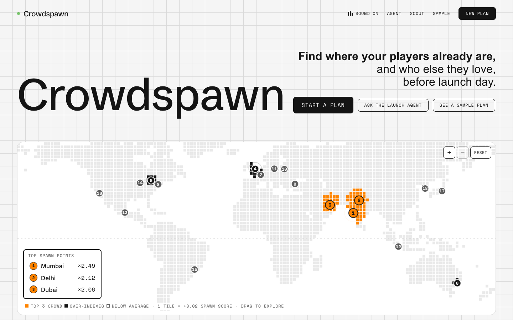

# Crowdspawn

**Find where your players already are, and who else they love, before launch day.**

Crowdspawn gives indie game studios a launch plan built from [Qloo Taste AI](https://qloo.com) data: the cities where fans of comparable games over-index against mainstream gamers, the audience's age and gender skew, the artists, podcasts, films and brands those fans love, and a budget split. An LLM writes the brief from that data only, and every claim links back to the Qloo call that produced it.

Built for the Qloo Agentic Hackathon 2026.



## Features

### 1. Launch agent (`/agent`)

The Qloo agent. Describe your game and your question. An LLM plans step by step with Qloo tools (`search_games`, `search_culture`, `find_place`, `rank_cities`, `scout_place`, `audience`, `find_partners`, `finish`), and every step streams live: the tool, its arguments, the agent's reasoning and what Qloo returned.

| Each step, live | The answer, checked against Qloo |
|---|---|
|  |  |

- **It can't invent data.** The agent refers to entities by handles the server issued (`g1`, `c2`, `p1`), so it never sees or makes up a Qloo id. Its answer may only use numbers and names that appeared in tool results; otherwise it retries once, then a template built from the Qloo ranking replaces it.
- **Bounded.** At most 10 steps, 12 LLM calls and 150 Qloo calls per run. Auth, budget and rate-limit errors fail closed.
- **Hands off.** "Open as a launch plan" fills the plan form with the agent's comps, culture anchors, platforms and cities.

### 2. Launch plan (`/plan/new`, `/sample`)

A three-level form: your game and platforms, comparable games ("rivals", with LLM suggestions that Qloo must resolve) and the culture your setting draws on, then the cities to score.


The plan streams in step by step. Cities are ranked by **spawn score = taste lift × platform fit × culture fit**, each with a confidence level and a budget share.


**Rivals and audience.** Your comps, the games Qloo says their fans also love (with why), and the audience's age and gender over- or under-index.


**Allies to recruit.** Artists, podcasts, films and brands the audience loves, globally and in the top cities: co-marketing and sponsorship leads, with Qloo's reasons and loot-rarity tiers by affinity.


**Battle plan.** An LLM brief written only from the plan's facts. Every highlighted name and number is checked, and each citation chip (`q12`) links to the Qloo call behind it. Limits are stated next to it.


An optional gap view compares the audience with your last game (`/v2/analysis/compare`). Plans export as Markdown or print.

### 3. Qloo call trace (`/plan/{id}/trace`)

Every Qloo call a plan made: step, endpoint, parameters, cache hit or live, status and time. The API key is never recorded.


### 4. Region scout (`/scout`)

The other question: *what works in a place?* A pixel-tile world map with real country borders, shaded by each country's Qloo **gamer taste match** (0-100: mean affinity rank of PC, console and mobile hit-game panels in its main cities; a taste score, not a player count, since Qloo has no player counts). Hover a country for its readings; drag, scroll or pinch to zoom.


Click anywhere, search a town (Qloo locality search) or pick a popular place. Hovering a popular place zooms the map to it; 50 of them are pre-scouted in a bundled Qloo snapshot (`apps/api/scripts/snapshot_scout.py`) and answer instantly.

- **Genres that over-index there:** 15 genre panels (3-4 well-known games each) scored against all gamers in the area.
- **Games locals love:** Qloo video game insights with `signal.location`.


**Will my game work here?** Describe your game. An LLM proposes comparable games and the culture it draws on (names only); Qloo resolves each one and scores the spot against 8 reference cities with the plan's spawn score. You get a loot-rarity verdict (Legendary, Epic, Rare, Uncommon, Common) with an estimated probability that players there over-index for your game (capped at 3-97% and pulled toward 50% when confidence is low; a model estimate, not sales odds), the ranking, top genres, local favourites and a short explanation whose numbers are checked against the facts.


Areas with no Qloo cells widen to 120 km, then snap to the nearest city with a reading. Panels are cached for a week; a new area costs about 19 calls.

### 5. Fails closed

Without a working Qloo key nothing is produced: no cities, no brief, and no LLM call. The UI says why.


### 6. Feel

Sketchpad grid squares rise into 3D blocks under the mouse (only where nothing sits on top of them). Sound effects are 8-bit blips synthesized at runtime with the Web Audio API, so there are no audio files and nothing to license; the nav toggle mutes them and remembers the choice.

## Quick start

Requirements: Node 24+, pnpm 11, [uv](https://docs.astral.sh/uv/) (Python 3.12 is fetched by uv).

```sh
pnpm install          # also runs `uv sync` for the API (postinstall)
cp apps/api/.env.example apps/api/.env          # then fill in QLOO_API_KEY and OLLAMA_API_KEY
cp apps/web/.env.example apps/web/.env.local
pnpm dev              # starts web (http://localhost:3000) and API (http://localhost:8000) together
```

`/sample` works with no keys at all. Without `OLLAMA_API_KEY` plans still work and the brief falls back to a grounded template. Without `QLOO_API_KEY` no plan is produced (see the kill-switch test). To put a live demo online, see [`docs/DEPLOY.md`](docs/DEPLOY.md). Full setup, commands and contribution rules: [`CONTRIBUTING.md`](CONTRIBUTING.md). MIT licensed.

## Who it's for

- **Buyer:** indie studios and small publishers planning a launch with a limited marketing budget (about 20,000 games launched on Steam in 2025). Free scouting and a paid full launch plan with partner leads is the obvious model.
- **Next:** the same taste geography works for any entertainment launch: a film's release cities, a tour, a podcast, an esports team's next market. Partner panels double as co-marketing and sponsorship leads.

## Trust and safety

- The LLM never supplies data. It proposes names (Qloo must resolve them) and writes words; numbers and names in its text are checked against Qloo results.
- Fail closed: without a working Qloo key nothing is produced (kill-switch test).
- No personal data: Qloo's taste data is PII-free and Crowdspawn stores none; keys never reach the browser.
- Honest outputs: "affinity index, not a sales forecast" everywhere; probabilities capped at 3-97% and labelled as estimates; accuracy misses published.

## Architecture

```
Browser (Next.js 16, apps/web)
   |  fetch + Server-Sent Events          no keys ever reach the browser
   v
FastAPI (apps/api)
   |-- routes --> orchestrator S1..S8 ---- progress events --> SQLite event log --> SSE
   |       |-- QlooClient --(X-Api-Key)--> hackathon.api.qloo.com
   |       |       token bucket (4 rps), retries, SQLite cache, per-run call cap, call trace
   |       '-- LLMProvider --> Ollama Cloud | Gemini | any OpenAI-compatible | Fake
   '-- SQLite: plans, events, traces, cache
packages/contracts: TS types generated from apps/api/openapi.json
```

## The Qloo call chain

Each step depends on the one before it. All parameters were verified live and recorded in [`docs/qloo-contract.md`](docs/qloo-contract.md).

| Step | Qloo call | Output |
|---|---|---|
| S1 Resolve comps and culture | `/entities` (plan) or `/search` (picker, LLM suggestions) | Real Qloo video game ids, plus optional culture anchors (films, shows, artists of the game's setting); unknown names are dropped, never invented |
| S2 Expand | `/v2/insights` `filter.type=urn:entity:videogame` + explainability | 20 similar games with the comps that drive each one |
| S3 Cities | `urn:heatmap` per city for the comp set, PC, mobile and console player panels, and the culture anchors | **Spawn score = taste lift × platform fit × culture fit** (all ratios of mean `affinity_rank`), with confidence |
| S4 Audience | `urn:demographics` | Age and gender over/under-index |
| S5 Partners | `/v2/insights` for artist, podcast, movie, brand (+ `signal.location` for the top 3 cities) | Partners with affinity and Qloo's reasons |
| S6 Gap (optional) | `/v2/analysis/compare` | Tastes shared with your last game vs new ground |
| S7 Budget | none, deterministic | Split by spawn score × confidence, sums to exactly 100% |
| S8 Brief | none, LLM over S1–S7 facts | Prose that cites `[q12]` result ids; validated before display |

A plan with 5 comps, 4 culture anchors and 18 cities uses about 107 Qloo calls; the player panels are shared across plans and cached, so a new plan usually costs about 2 live calls per city, and 0 on repeat.

### Why it can't exist without Qloo (the swap test)

Every city, entity, score and audience figure carries `source: "qloo"` and a `result_id` in the trace (tested: Q1). The LLM only suggests comp *names* (which Qloo must resolve) and words the brief. A grounding validator rejects any city, bold name, number or citation not present in the Qloo results, regenerates once, then falls back to a template (L7).

**Kill-switch test:** with `QLOO_API_KEY` empty or wrong, a plan ends `failed` with `qloo_unconfigured` / `qloo_auth`, no cities or brief are produced, and no LLM call is made (`tests/test_api.py::test_kill_switch_*`, and the error screen in the UI).

**LLM-swap test:** switching `LLM_PROVIDER` between `ollama_cloud`, `gemini`, `openai_compat` and `fake` changes only the brief; the rest of the plan JSON is identical (`test_provider_swap_changes_only_brief`). Only `apps/api/src/crowdspawn_api/llm/` names a provider (grep test).

## Honest limits

- It's an **affinity index** from taste data, not a sales or wishlist forecast.
- New indie games are rarely in Qloo, so plans work through comparable games (16 of 20 recent indie titles resolved in Phase 0).
- **Accuracy scenarios:** 10 independent hypothetical games checked against Google Trends interest for a real shipped analogue (never used as a comp). The true #1 country was our #1 in **6 of 10** and in our top 3 in **8 of 10**; the original lift-only ranking managed 2 and 5. It misses where Qloo's data is thin (mobile MOBAs in Southeast Asia, Football Manager in Korea). Full table: [`docs/scenario-results.md`](docs/scenario-results.md). The earlier Steam-language backtest of the old ranking is in [`docs/backtest-results.md`](docs/backtest-results.md).
- City-level accuracy cannot be validated with free public data.
- Brands are global: Qloo's brand affinity ignores location.

## Repo map

```
apps/api      FastAPI: qloo/ (client, cache, trace), pipeline/ (S1-S8, agent, scout, judge), llm/ (providers, prompts), grounding.py
apps/web      Next.js: app/ routes, components/ (SpawnMap, RegionScout, LaunchAgent, PlanView, LivePlan, TraceView, NewPlanForm, TileField, Sfx), lib/
packages/contracts   generated API types
docs/         product spec, verified Qloo contract, progress, decisions, backtest results
```

Progress against every acceptance criterion is tracked in [`docs/progress.md`](docs/progress.md); decisions in [`docs/10-risks-decisions.md`](docs/10-risks-decisions.md).
