<p align="center">
  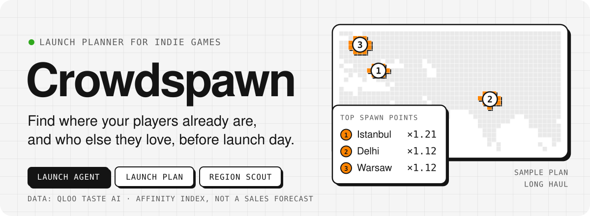
</p>

<p align="center">
  <a href="#quick-start">Quick start</a> ·
  <a href="#three-ways-in">Features</a> ·
  <a href="#how-it-works">How it works</a> ·
  <a href="#trust-and-limits">Limits</a> ·
  <a href="CONTRIBUTING.md">Contributing</a>
  <br>
  <sub>Built for the Qloo Agentic Hackathon 2026 · MIT licensed</sub>
</p>

<p align="center">
  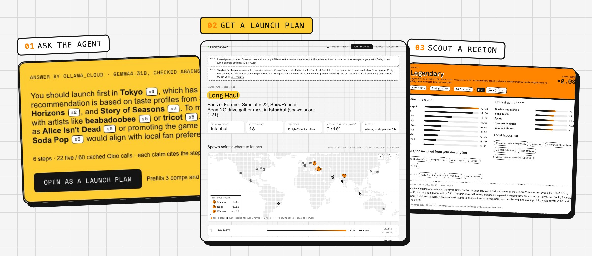
</p>

Crowdspawn gives indie game studios a launch plan built from [Qloo Taste AI](https://qloo.com) data. It shows the cities where fans of games like yours over-index against all gamers, who that audience is, and which artists, podcasts, films and brands they love. An LLM explains the result but never supplies a fact: every city, name and number traces back to the Qloo call that produced it.

New here? Press **Tour** in the app's nav for a one-minute guided walk through the map, a full plan, the region scout and the agent.

## Three ways in

### 01 · Ask the launch agent — `/agent`

Describe your game and your question. An LLM plans step by step with Qloo tools (`search_games`, `search_culture`, `find_place`, `rank_cities`, `scout_place`, `audience`, `find_partners`, `finish`), and each step streams live with its reasoning and what Qloo returned.

| Each step, live | The answer, checked against Qloo |
|---|---|
| 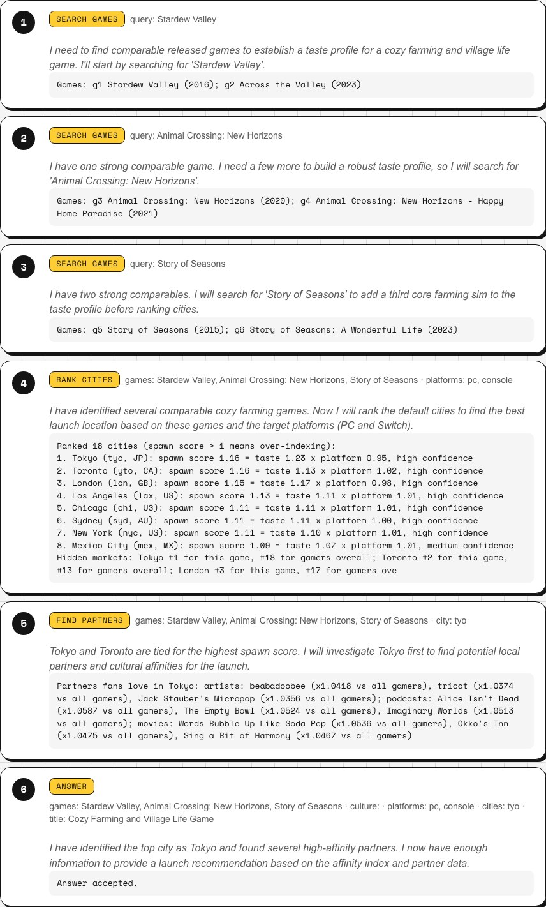 | 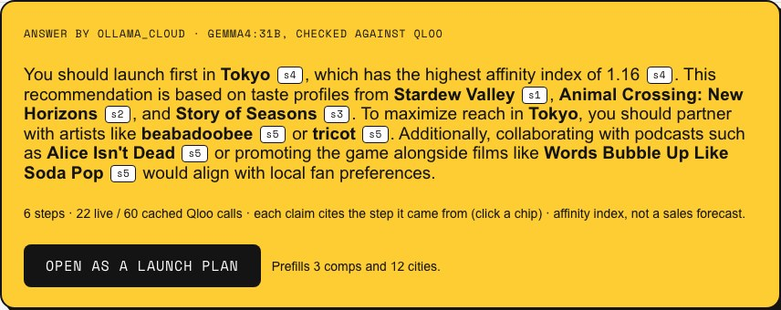 |

- **It can't invent ids.** The agent refers to entities by handles the server issues (`g1`, `c2`, `p1`).
- **It can't invent facts.** Its answer may only use names and numbers from tool results. If it fails the check, it retries once, then a template built from the Qloo ranking replaces it.
- **It's bounded.** At most 10 steps, 12 LLM calls and 150 Qloo calls per run. Auth, budget and rate-limit errors fail closed.
- **It hands off.** "Open as a launch plan" fills the plan form with the agent's picks.

### 02 · Get a launch plan — `/plan/new` · `/sample`

Three levels: your game and platforms, then comparable games and the culture your setting draws on (the LLM suggests names; Qloo must resolve them), then the cities to score. The plan streams in step by step.

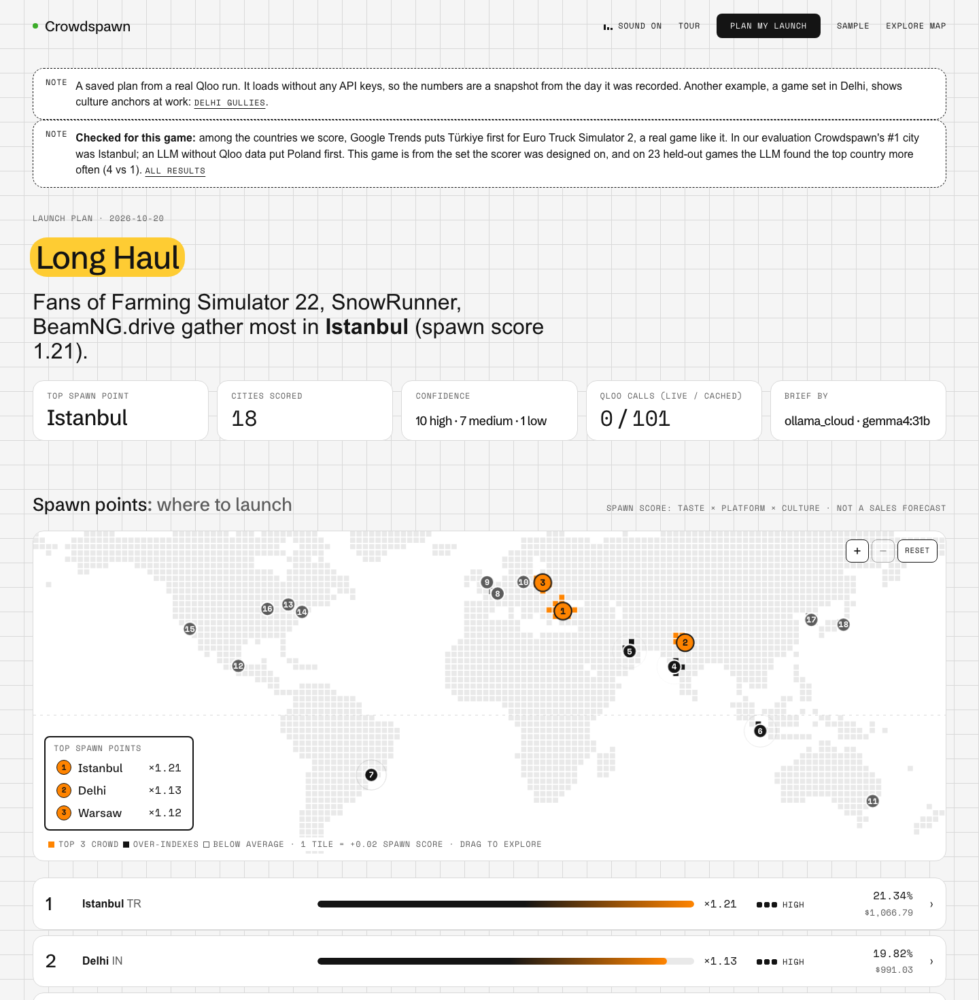

- **Spawn points:** cities ranked by spawn score, each with a confidence level and a budget share.
- **Rivals and audience:** the games Qloo says your comps' fans also love, with why, plus the audience's age and gender skew.
- **Allies to recruit:** artists, podcasts, films and brands the audience loves, globally and in the top cities. These are co-marketing and sponsorship leads.
- **Battle plan:** a brief written only from the plan's facts. Each citation chip (`q12`) opens the Qloo call behind it.
- **Gap view (optional):** tastes you share with your last game, and new ground.

<details>
<summary><b>See the rest of the plan</b>: rivals, partners, brief, call trace, and the form</summary>

<br>

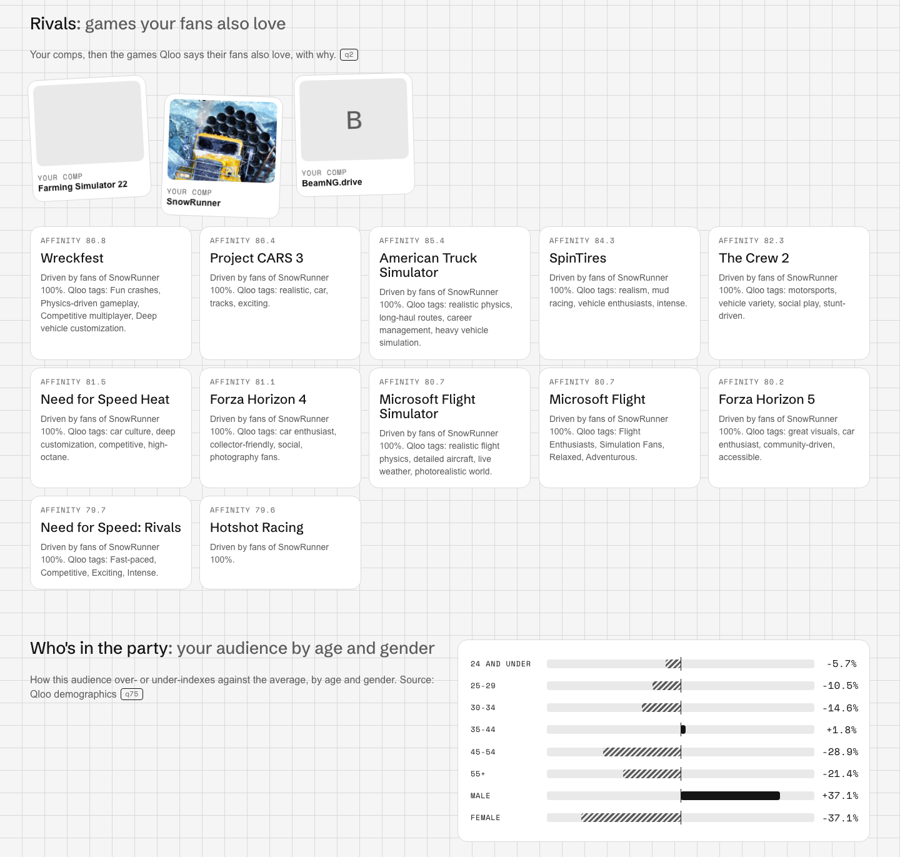

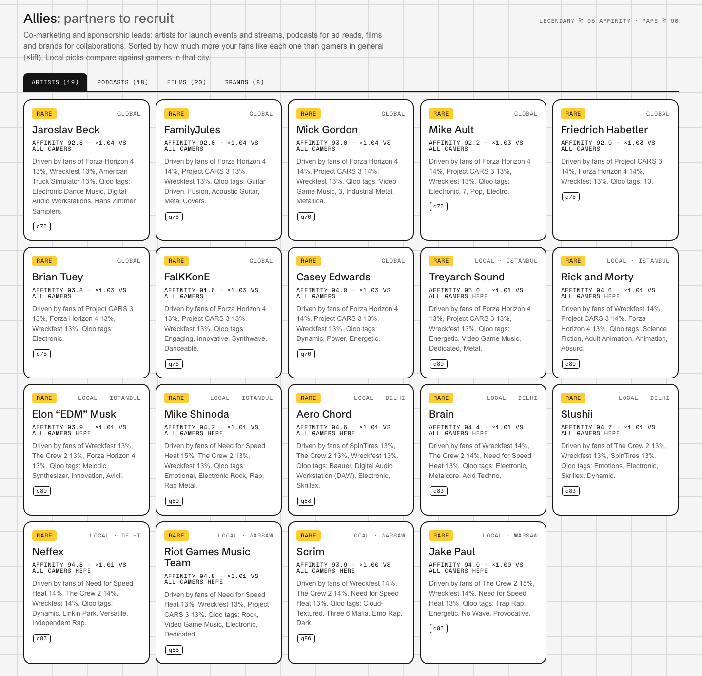

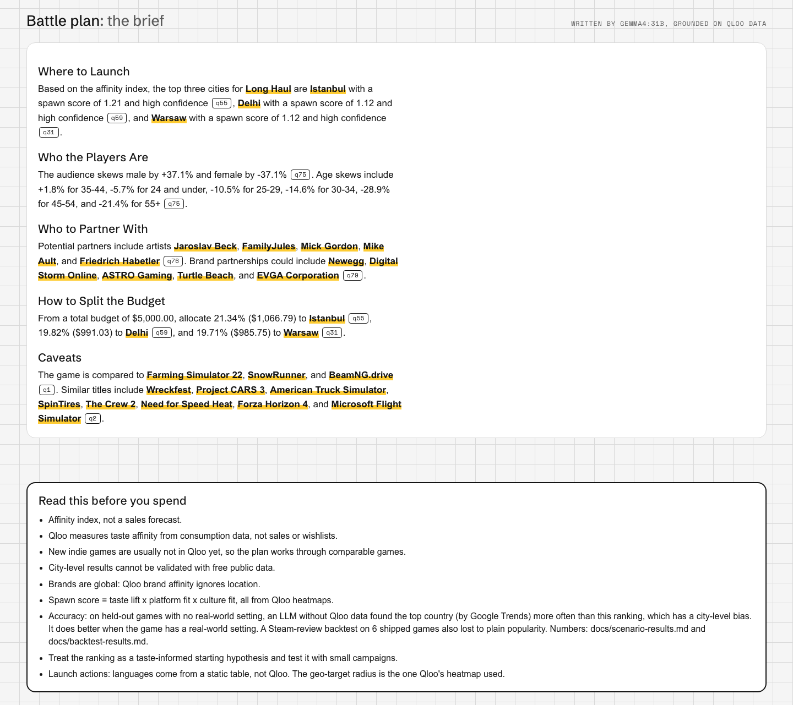

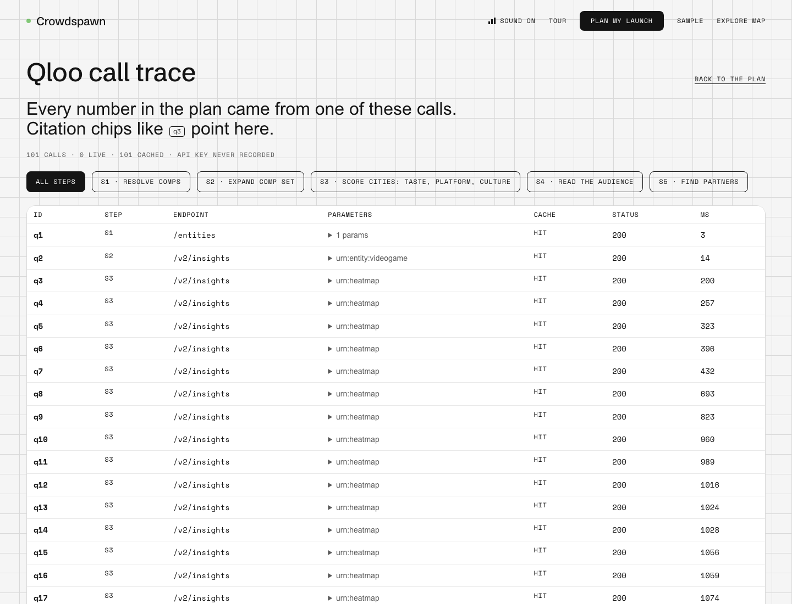

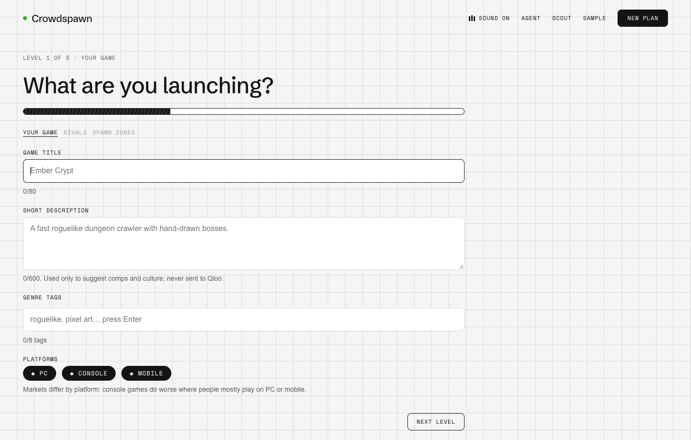

</details>

### 03 · Scout a region — `/scout`

What works in a place? A pixel world map with real country borders, shaded by each country's **gamer taste match**. That's a 0–100 taste score built from PC, console and mobile hit-game panels, not a player count; Qloo has no player counts.

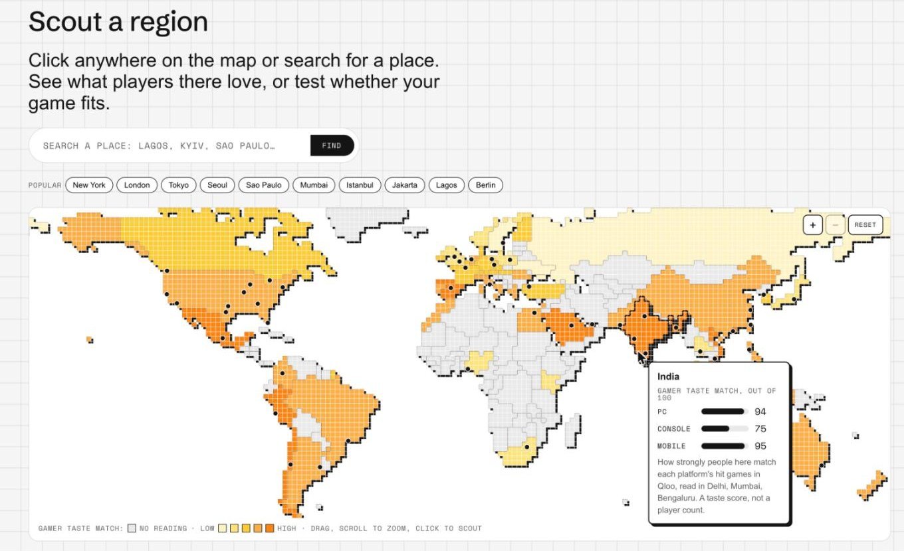

Click anywhere, search a town or hover a popular place to zoom to it. You see the genres that over-index there, against all gamers in the area, and the games locals love. 50 popular places are pre-scouted into a bundled Qloo snapshot and answer instantly.

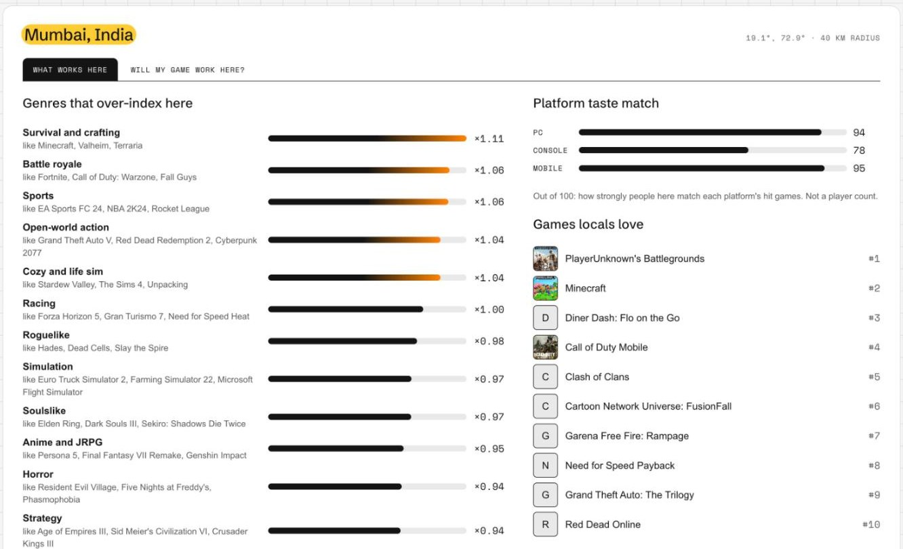

**Will my game work here?** Describe your game and get a loot-rarity verdict (Legendary, Epic, Rare, Uncommon, Common). Each word is a band of the spawn score, stricter when Qloo's data is thinner: Legendary needs 1.15 or more at high confidence. It is not a probability. You also get a ranking against 8 world cities and the names Qloo matched.

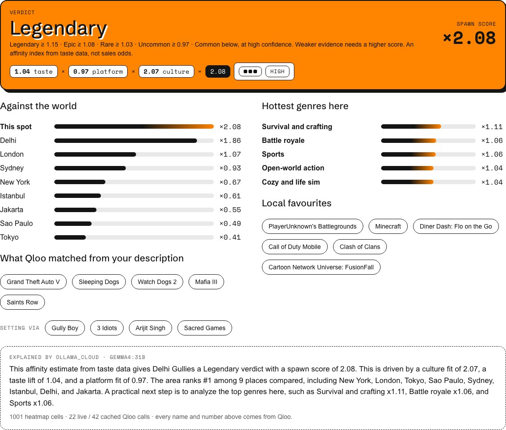

## How it works

<p align="center">
  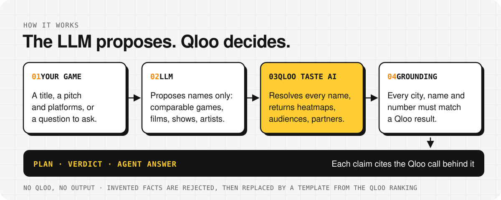
</p>

Every city is ranked by one transparent score. Each factor is a ratio of Qloo affinity ranks, with no tuned weights:

<p align="center">
  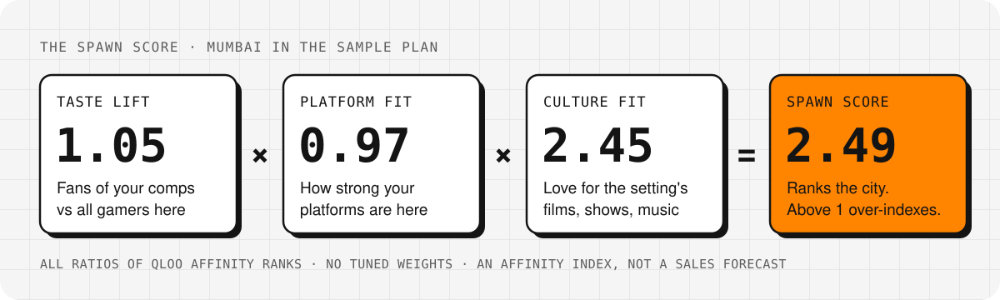
</p>

- **Taste lift:** how much fans of your comparable games concentrate in the city, compared with all gamers there. "All gamers" is the mean of PC, console and mobile player panels.
- **Platform fit:** how strong your platforms are in that city.
- **Culture fit:** how concentrated fans of your setting's films, shows and music are, relative to the average city.

**Is it right?** Not yet, on its own. We wrote 23 held-out test games with no home-country setting and froze them before scoring. For each, Google Trends interest for a real shipped game like it (never a comp) is the truth, and every method ranks the same candidate countries:

| Method | Trends #1 is our #1 | Trends #1 in our top 3 | Mean ρ |
|---|---|---|---|
| Crowdspawn (Qloo spawn score) | 1 of 23 | 1 of 23 | 0.11 |
| LLM only (gemma4:31b) | 4 of 23 | 7 of 23 | 0.54 |
| Popularity (all gamers, no game signal) | 0 of 23 | 1 of 23 | -0.33 |

An LLM with no Qloo data did better. The ranking has a city bias: its #1 city was Stockholm for 9 and Istanbul for 6 of the 23 games, whatever the genre. It does better when a game has a real-world setting, where culture anchors carry the signal. On the 10-game tuning set (9 shipped games and 1 cancelled one, Mumbai Gullies) it found the #1 in 6 of 10 (5 of the 9 shipped), the same as the LLM (6 of 10), but the scorer was designed on those games. A Steam-review backtest on 6 shipped games also lost to plain popularity. Everything is published: [`docs/scenario-results.md`](docs/scenario-results.md), [`docs/backtest-results.md`](docs/backtest-results.md), and the app's "How accurate is it?" page.

<details>
<summary><b>The Qloo call chain</b>: each plan step and the call behind it</summary>

<br>

All parameters were verified live and recorded in [`docs/qloo-contract.md`](docs/qloo-contract.md).

| Step | Qloo call | Output |
|---|---|---|
| S1 Resolve comps and culture | `/entities` or `/search` | Real Qloo ids for comps and culture anchors; unknown names are dropped, never invented |
| S2 Expand | `/v2/insights` video games + explainability | 20 similar games with the comps that drive each one |
| S3 Cities | `urn:heatmap` for the comps, the platform panels and the culture anchors | Spawn score with confidence |
| S4 Audience | `urn:demographics` | Age and gender over/under-index |
| S5 Partners | `/v2/insights` artist, podcast, movie, brand (+ `signal.location` for the top 3 cities), each re-scored against all gamers with `filter.entities` | Partners ranked by lift vs all gamers, with Qloo's reasons |
| S6 Gap (optional) | `/v2/analysis/compare` | Tastes shared with your last game vs new ground |
| S7 Budget | none, deterministic | Split by spawn score × confidence, sums to exactly 100% |
| S8 Brief | none, LLM over S1–S7 facts | Prose citing `[q12]` result ids, validated before display |

A plan with 5 comps, 4 culture anchors and 18 cities uses about 120 Qloo calls, 26 of them for partners. The per-run cap is 140. Player panels are shared and cached, so a new plan usually costs about 2 live calls per city, and 0 on repeat.

</details>

<details>
<summary><b>The swap and kill-switch tests</b>: proof that Qloo is load-bearing</summary>

<br>

- **Every fact is traced.** Every city, entity, score and audience figure carries `source: "qloo"` and a `result_id` in the trace. A grounding validator rejects any city, bold name, number or citation not present in the Qloo results. It regenerates once, then falls back to a template.
- **Kill switch.** With `QLOO_API_KEY` empty or wrong, a plan ends `failed` with `qloo_unconfigured` / `qloo_auth`. No cities or brief are produced and no LLM call is made (`tests/test_api.py::test_kill_switch_*`).
- **LLM swap.** Switching `LLM_PROVIDER` between `ollama_cloud`, `gemini`, `openai_compat` and `fake` changes only the brief; the rest of the plan JSON is identical (`test_provider_swap_changes_only_brief`). Only `apps/api/src/crowdspawn_api/llm/` names a provider.

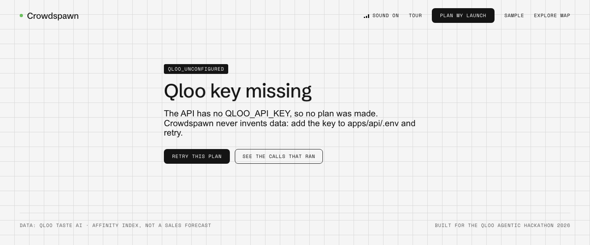

</details>

## Quick start

Requirements: Node 24+, pnpm 11 and [uv](https://docs.astral.sh/uv/). uv fetches Python 3.12 for you.

```sh
pnpm install                                   # also runs `uv sync` for the API
cp apps/api/.env.example apps/api/.env         # fill in QLOO_API_KEY and OLLAMA_API_KEY
cp apps/web/.env.example apps/web/.env.local
pnpm dev                                       # web http://localhost:3000 · API http://localhost:8000
```

- **No keys:** `/sample` and the 50 bundled scout places still work.
- **No `OLLAMA_API_KEY`:** plans still work, and the brief falls back to a grounded template.
- **No `QLOO_API_KEY`:** nothing is produced. That's by design.

| Command | What it does |
|---|---|
| `pnpm dev` | Web + API with hot reload |
| `pnpm test` | API pytest on recorded Qloo fixtures (no network, 80% coverage gate) + web Vitest |
| `pnpm lint` · `pnpm check-types` | ruff + ESLint · mypy --strict + tsc |
| `pnpm build` | Exports `openapi.json` and builds the Next.js app |
| `pnpm contracts` | Regenerates the TypeScript API types |

To put a demo online, see [`docs/DEPLOY.md`](docs/DEPLOY.md). Full setup and contribution rules are in [`CONTRIBUTING.md`](CONTRIBUTING.md).

## Trust and limits

- **The LLM never supplies data.** It proposes names, which Qloo must resolve, and writes words that are checked against Qloo results.
- **Fail closed.** Without a working Qloo key nothing is produced.
- **No personal data.** Qloo's taste data is PII-free, Crowdspawn stores none, and keys never reach the browser.
- **An affinity index, not a sales or wishlist forecast.** Scout verdicts (Legendary to Common) are spawn-score bands, not probabilities.
- **Comparable games.** New indie games are rarely in Qloo, so plans work through comparable games; 16 of 20 recent indie titles we tested resolved.
- **Accuracy limits.** On held-out games with no real-world setting the country ranking lost to an LLM without Qloo data, and a [Steam-review backtest](docs/backtest-results.md) lost to plain popularity. City-level accuracy can't be validated with free public data. Treat the ranking as a starting hypothesis.
- **Brands are global.** Qloo's brand affinity ignores location.

## Who it's for

- **Indie studios and small publishers** planning a launch on a small marketing budget. About 20,000 games launched on Steam in 2025.
- **Next:** any entertainment launch, such as a film's release cities, a tour, a podcast or an esports team's next market.

<details>
<summary><b>Architecture and repo map</b></summary>

<br>

```
Browser (Next.js 16, apps/web)
   |  fetch + Server-Sent Events          no keys ever reach the browser
   v
FastAPI (apps/api)
   |-- routes --> plan S1..S8 · agent · scout · judge -- progress events --> SQLite event log --> SSE
   |       |-- QlooClient --(X-Api-Key)--> hackathon.api.qloo.com
   |       |       token bucket (4 rps), retries, SQLite cache, per-run call cap, call trace
   |       '-- LLMProvider --> Ollama Cloud | Gemini | any OpenAI-compatible | Fake
   '-- SQLite: plans, runs, events, traces, cache
packages/contracts: TS types generated from apps/api/openapi.json
```

```
apps/api      FastAPI: qloo/ (client, cache, trace), pipeline/ (S1-S8, agent, scout, judge), llm/ (providers, prompts), grounding.py
apps/web      Next.js: app/ routes, components/ (SpawnMap, RegionScout, LaunchAgent, PlanView, LivePlan, TraceView, NewPlanForm, TileField, Sfx), lib/
packages/contracts   generated API types
assets/readme        README art; the hero is generated from the app's own country map (source/build_hero.py)
docs/         how it works, verified Qloo contract, accuracy results, deploy guide
```

A plain-language walkthrough is in [`docs/HOW-IT-WORKS.md`](docs/HOW-IT-WORKS.md), and the verified Qloo calls in [`docs/qloo-contract.md`](docs/qloo-contract.md).

</details>

## Contributing and licence

Setup, commands, ground rules and PR conventions are in [`CONTRIBUTING.md`](CONTRIBUTING.md). Crowdspawn is MIT licensed; see [`LICENSE`](LICENSE).
